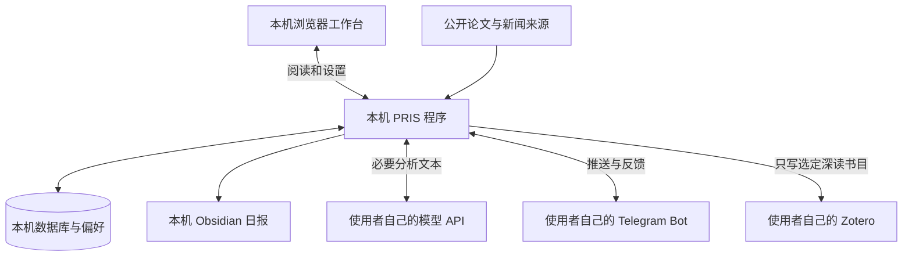

# PRIS 本地部署与网页设置

_一份程序，每位使用者独立配置自己的模型、Bot 和研究库。_

---

## 📋 网页、程序和 Bot 的关系

网页是本机 PRIS 的控制台，不是另一套系统。它通过本机接口读写论文、日报、偏好和反馈；Telegram 是可选的手机推送及反馈通道。



只监听 `127.0.0.1`，不需要公网 IP、端口转发、租用服务器或作者账号。每个使用者的实例、数据和凭据相互独立。仅复制 HTML 文件不能运行完整功能，需要整个项目和 Python 后端。

## ⚙️ 从干净电脑开始

需要 Python 3.11 或更新版本。本地工作台无需 Node.js；Windows 的双击启动和定时任务需 Python 加入 PATH。

先下载仓库的完整源码并进入项目目录，再执行：

```powershell
python -m venv .venv
.\.venv\Scripts\python.exe -m pip install -e .
.\.venv\Scripts\python.exe -m pris.app --root . ui
```

打开 `http://127.0.0.1:8765`。首次启动从 `config.example.toml` 建立本机基础配置，数据库及日报目录自动创建，不包含作者的研究资料。

macOS/Linux 可使用 `.venv/bin/python` 启动同一工作台，但 Windows 的任务安装脚本与凭据加密入口不适用于这些系统。

## 🔌 在网页完成自己的配置

1. 打开左侧「连接与设置」。当前模型适配器为 DeepSeek，不代表填写别家模型名就能兼容。
2. Windows 用户可以填写自己的 API Key，选择模型、日报思考模式、预算与估算单价，然后保存。
3. 如需手机推送，自己在 BotFather 创建 Bot，给 Bot 发消息，并填写自己的 Token 和数字 Chat ID。
4. 如需深读书目同步，填写自己的 Zotero 专用 Key 和数字 User ID；也可关闭 Telegram/Zotero，单独使用本地工作台。
5. 在「兴趣与偏好」修改子主题、配比、排除词、篇数、来源开关与解读风格。保存后下一次任务读取新设置。
6. 可主动点击 API 检查，查询官方接口的模型列表；该检查不发送论文、兴趣画像或对话。API 路径依据官方模型列表接口[^1]。

凭据输入框留空代表保留原值。已保存的值不返回浏览器，不支持显示或导出密钥。保存配置本身不联系外部服务。

## 🔐 保存位置与安全边界

| 文件 | 保存内容 | 是否提交 Git |
| --- | --- | --- |
| `config.example.toml`、`.env.example` | 无密钥的默认配置 | 是 |
| `config.toml`、`.env` | 本机基础配置、原有凭据 | 否 |
| `data/connections.json` | 模型预算、开关、加密凭据 | 否 |
| `data/preferences.json` | 个人兴趣设置 | 否 |
| `data/pris.db`、`vault/PRIS/` | 论文、日报、反馈、对话 | 否 |

Windows 网页新增的凭据通过当前用户 DPAPI 加密；解密通常依赖保存时的系统账号和电脑[^2]。加密失败会停止保存，不回退明文。已有 `.env` 仍是明文，本功能不自动迁移或删除它。

凭据读取优先级：网页管理的加密值 → 进程环境变量 → 当前项目 `.env`。运行设置优先级：网页连接设置覆盖 `config.toml` 对应模型、预算和开关；兴趣设置独立保存。读取一个项目的 `.env` 不会把它注入全局环境或污染另一个项目。

不要把凭据文件复制给其他使用者。自己的另一台电脑也应重新录入凭据。DPAPI 不防同一账号下的恶意程序，不是整库加密。论文库及 Markdown 仍是普通本机文件。

本地运行不等于完全离线：模型解读需发送必要文本，Telegram 接收推送，Zotero 接收选中的书目。未公开原始科研数据不应自动交给这些服务。

## ⏰ 运行和更新

可以在主页手动生成日报。每日自动运行需另行安装 Windows 定时任务；默认 00:30，电脑必须在可运行状态。保存网页配置不会偷偷安装任务、改变运行时间或启动云端任务。

在本机知识库路径保持不变的情况下更新源码，再重启界面即可。自己的 `.env`、`data/`、`vault/` 不随 Git 更新替换。尚未宣布 macOS/Linux 的自动任务安装支持。

当前仓库尚需完成许可证、云端遗留代码清理和公开发布审核；此说明不表示已经向公众开放仓库。

## 🔗 参考

[^1]: DeepSeek. "Lists Models." https://api-docs.deepseek.com/api/list-models/
[^2]: Microsoft. "Example C Program: Using CryptProtectData." https://learn.microsoft.com/en-us/windows/win32/seccrypto/example-c-program-using-cryptprotectdata
